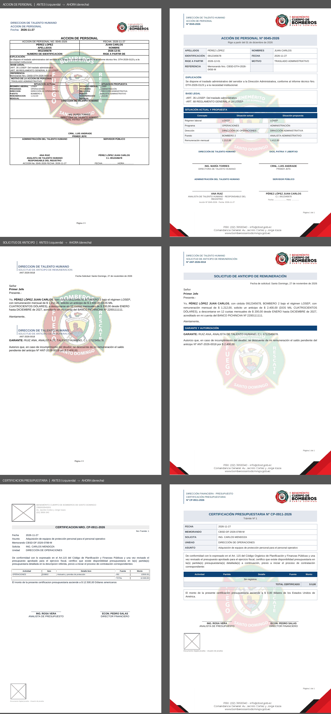

# Reportería: formato institucional y rendimiento

## Formato base (`kconfig/reporte.php`)

Mismo diseño que la orden de pago (`kcontabilidad/reportes/ficheropagoorden.php`) y los reportes de BCBSD-Api,
pero con **dompdf** (`lib/dompdf`, la librería única del sistema), sin depender de copias de html2pdf por módulo
(la de contabilidad, `kcontabilidad/reportes/vendor`, ni siquiera está en el repositorio).

- Cabecera: bloque azul con **área / documento / número** y el logo institucional.
- El escudo («Benemérito Cuerpo de Bomberos») como marca de agua.
- Pie institucional (dirección, teléfonos, web) con «Página X de Y».
- Vertical (`'orientacion' => 'P'`) u horizontal (`'L'`), A4, carta u oficio; márgenes configurables.
- Imágenes optimizadas en `kimages/reportes/` (86 KB en total).

```php
require_once __DIR__ . '/../kconfig/reporte.php';
$r = new KReporte(array(
    'area'        => 'DIRECCIÓN DE TALENTO HUMANO',
    'documento'   => 'ACCIÓN DE PERSONAL',
    'numero'      => 'Nº 0045-2026',
    'orientacion' => 'P',
    'archivo'     => 'accion_personal_0045',
));
$r->agregar(kr_titulo('Acción de personal Nº 0045-2026', 'Rige a partir del 01 de diciembre de 2026'));
$r->agregar(kr_datos(array('Apellidos' => $a, 'Nombres' => $n, 'Cédula' => $c), 2)); // grilla etiqueta/valor
$r->agregar(kr_texto($texto, 'Explicación'));                                         // recuadro con título
$r->agregar(kr_bloque('Detalle'));                                                    // banda de sección
$r->agregar(kr_tabla(array('Partida', 'Detalle', 'Monto'), $filas, array('', '', 'derecha'),
                     array(array('TOTAL', 2), kr_dinero($total))));                   // tabla con total
$r->agregar(kr_firmas(array(array('titulo' => 'Elaborado por', 'nombre' => $n, 'cargo' => $c))));
$r->enviar();
```

Ayudas: `kr_e()` (escapar), `kr_dinero()` (1.234,56), `kr_fecha_larga()` (05 de noviembre de 2026), `kr_salto()`.
Para texto que ya es HTML (plantillas editables de la base), `$r->agregar($html)` tal cual.



## Reportes convertidos

| Reporte | Antes | Ahora |
|---|---|---|
| Acción de personal (`reportes/accion.php`) | TCPDF, logo de 5571×2076 px: **1,66 s y 2 MB** | **0,15 s y 79 KB** |
| Solicitud de anticipo (`reportes/SolicitudAnticipo.php`) | TCPDF, encabezado con tablas anidadas | formato institucional; el texto sigue saliendo de las plantillas editables `ven_plantilla` 1 y 2 |
| Certificación presupuestaria (`kpresupuesto/reportes/certificacion.php`) | encabezado simple | formato institucional; firmas desde la plantilla editable `par_reporte` `PR-CE`; QR del documento |

## Actas de bienes (rendimiento)

- `kactivos/reportes/formatos/HEADER_PROCESS_CBSD.html`: marca de agua de 2775×2775 px (1,5 MB) y logo de 299 KB
  reemplazados por versiones optimizadas del mismo diseño. Acta de entrega-recepción: **1,8 MB → 118 KB**.
- `kactivos/reportes/kreportes.php`: `GrillaBienes`, `GrillaBienesNuevo` y `GrillaBienesBaja` consultaban
  `activo.view_bienes` y `web_modelo` **por cada bien** (la segunda sin usar en dos de ellas). Ahora una sola
  consulta por acta (`_bienes_acta`): con 50 bienes, **102 → 3 consultas**, con la misma salida (verificado).
- `bien_componente_acta*`: la lista de bienes se cortaba en 1000 caracteres (actas grandes: consulta inválida o
  datos de otro bien) y fallaba con actas sin bienes (`IN ()`). Corregido.

## Siguientes reportes a convertir

Los reportes con el formato antiguo (encabezado con logo y texto, tablas `celda1`/`lado`) se pueden pasar al formato
base uno por uno con el mismo patrón: obtener los datos con la clase `kreportes.php` del módulo y armar el cuerpo con
`kr_*`.
